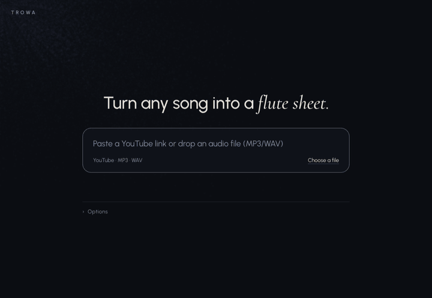
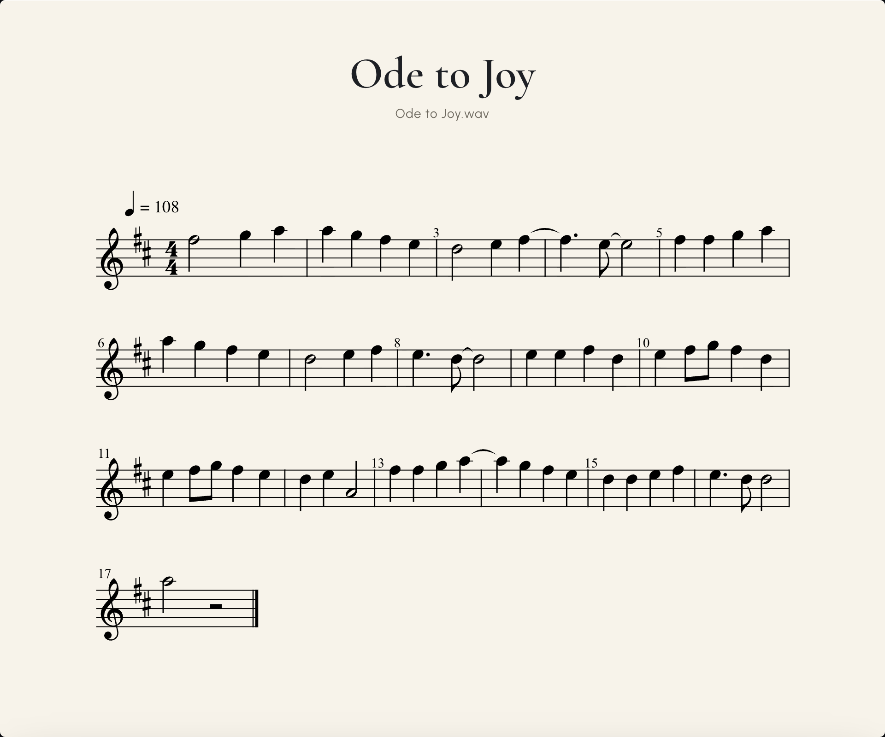

# Trowa

Turn a song into a printable flute sheet. Paste a YouTube link or drop an MP3/WAV, watch the particles translate it, then play back, transpose, and download the score as PDF or MusicXML.

The name comes from Trowa Barton, the [Gundam Wing character](https://static0.cbrimages.com/wordpress/wp-content/uploads/2020/01/Quatre-Trowa-1.jpg?q=50&fit=crop&w=825&dpr=1.5) who made me want to play the flute as a kid.



The demo is a real run on a synthesized Ode to Joy with chords, bass and drums (`ode-band` from the benchmark). The Demucs separation was cached, so the whole run took 7 seconds. A cold run separates on CPU first and takes minutes.



## Run it

Requires Node 22, plus `yt-dlp` and `ffmpeg` on `PATH` for YouTube links. `uv` is optional and enables Demucs separation.

```sh
npm install
PORT=5310 npm run dev
```

Open `http://localhost:5310/`. Add `?fake` to drive the UI with a canned score and no audio work. Set `TROWA_DEMUCS=off` to skip Demucs and use the in-browser lead filter.

## How it works

1. **Get the audio.** For a YouTube link, the server downloads the sound with `yt-dlp`. An uploaded MP3 or WAV is read in the browser.
2. **Isolate the lead.** Demucs, a source-separation model, pulls the singer or lead instrument away from the backing band. If Demucs is missing or returns near silence, a filter that keeps the middle frequencies takes over.
3. **Hear the notes.** Spotify's Basic Pitch runs in the browser. It estimates, many times a second, how likely each pitch is to be sounding.
4. **Follow the melody.** Those estimates are noisy, with chords, echoes and stray notes mixed in. A Viterbi tracker picks the single line that is most consistent over time. It favors held notes and small steps and avoids jumping around. It can also choose silence, so a passage that a flute can't play becomes a rest instead of wrong notes.
5. **Write the sheet.** The app detects the tempo, lines the notes up on a beat grid, finds the key, moves notes into flute range, and groups eighth notes. The result is MusicXML. OpenSheetMusicDisplay draws it, jsPDF exports it, the player plays it back, and Transpose shifts it to another key.

The translation animation runs while a background worker does the analysis, so the page doesn't freeze.

On five held-out recordings of real performances, the tracker scores an F0.5 of 0.73 on solo flute, 0.83 on flute with accompaniment, and 0.63 when another instrument carries the melody. F0.5 weights precision (no wrong notes) twice as heavily as recall (no missed notes). Tempo on rubato tracks can be off by a few percent. [docs/pipeline.md](docs/pipeline.md) explains each stage and its limits, and [docs/benchmark.md](docs/benchmark.md) has the full benchmark.

## Test

```sh
npm test
npm run typecheck
node scripts/demo-capture.mjs http://localhost:5310/ song.wav out/
```

The last command drives the real app headlessly, uploads `song.wav`, and writes the frames, a result screenshot and the sheet image to `out/`. It is how the demo above was made.
