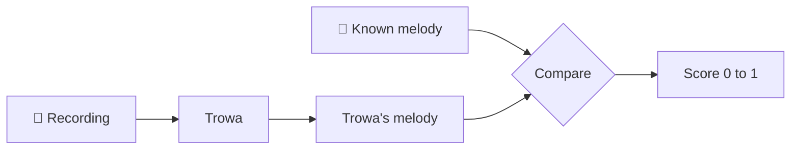
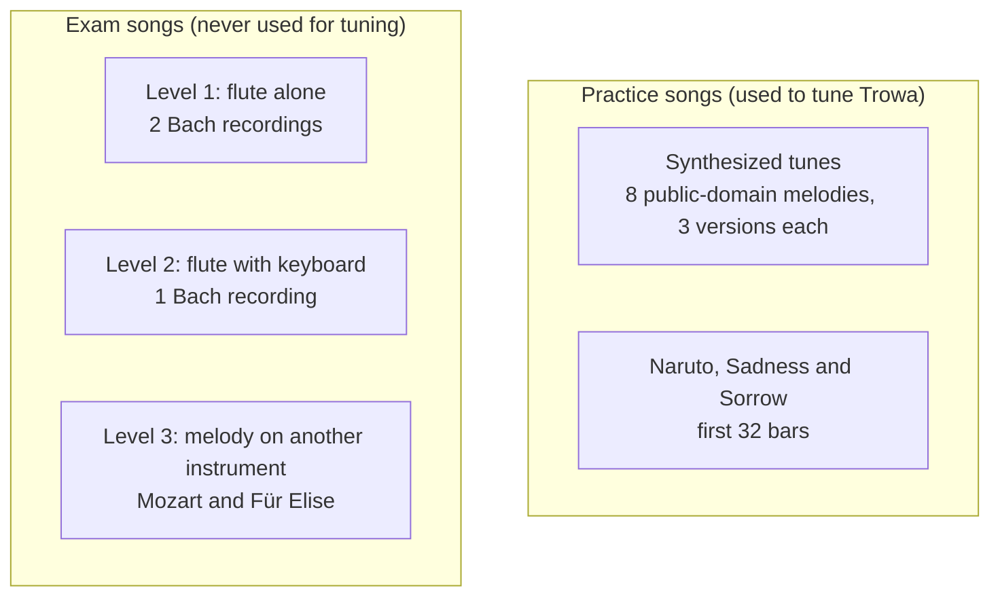

# How good is it?

To know whether a change makes Trowa better, we need songs where we already know the right melody. We feed each one to Trowa and compare its sheet with the real tune, note by note.



## The score

Trowa can be wrong in two ways. It can **write a wrong note**, or it can **miss a note**. A wrong note is worse for a flute player, because you play it and it sounds bad. A missed note is just a short rest. So the score, called F0.5, counts wrong notes twice as heavily as missed ones. 1.0 is perfect.

## The test songs

There are two kinds of songs, and they are used differently.



**Practice songs** are where we tried settings until the results looked good. Scores on them are flattering, like grading a student on the homework they already corrected. The synthesized tunes come in three versions: the melody alone, with a band, and with a louder piano an octave below.

**Exam songs** are real performances Trowa never saw while being tuned. Only these scores tell you how it does on a new song. Each exam song is freely licensed (Creative Commons or public domain), with a public-domain score from the Mutopia Project.

## Results

Exam songs, before and after the new melody tracker:

| Level | Songs | Before | After |
| --- | --- | --- | --- |
| 1, flute alone | 2 | 0.63 | 0.73 |
| 2, flute with keyboard | 1 | 0.78 | 0.83 |
| 3, melody on another instrument | 2 | 0.48 | 0.63 |

The tracker won on all five songs. Five songs is still a small sample. Read these as five data points, not a grade for each level.

On Naruto, a practice song, the score went from 0.39 to 0.64. Bars 12 to 15 still come out wrong.

**One setting is doubtful.** The "stay in your range" rule (step 3 in [pipeline.md](pipeline.md)) was added for Naruto. On the exam songs it helps two and hurts three, including both flute solos. It stays in until we compare Trowa against ready-made AI transcription models.

## How the known melody is lined up

A performer never plays exactly in time with the score. Before comparing, the score is stretched and squeezed in time to follow the recording, a technique called dynamic time warping. The report shows how well that lineup fit, so a bad lineup isn't mistaken for a bad transcription.

## Run it yourself

The audio isn't in the repo. The scripts download or generate it into `.cache/`.

```sh
# Practice songs: make the synthesized tunes, run the note model once, score them
npx tsx scripts/bench/synth.ts
for f in .cache/bench/*.wav; do n=$(basename "$f" .wav); npx tsx scripts/bench/dump.ts "$n" "$f" --filter; done
npx tsx scripts/bench/run.ts --approach tracker

# Exam songs: download them, then score
python3 scripts/bench/real/fetch.py
npx tsx scripts/bench/real.ts
```

| Script | What it does |
| --- | --- |
| `synth.ts` | Makes the synthesized tunes and saves the right answer next to each. |
| `dump.ts` | Runs the note-guessing model once per song and caches the result, so scoring is fast. |
| `run.ts` | Scores the practice songs. `--approach baseline` scores the old method for comparison. |
| `real.ts` | Scores the exam songs. `real/manifest.json` lists each song's source and license. |
| `inspect.ts <song> --from <sec> --to <sec>` | Shows the right answer, Trowa's line and the sheet side by side for a few seconds. |
| `bars.ts` | Scores Naruto bar by bar. |
