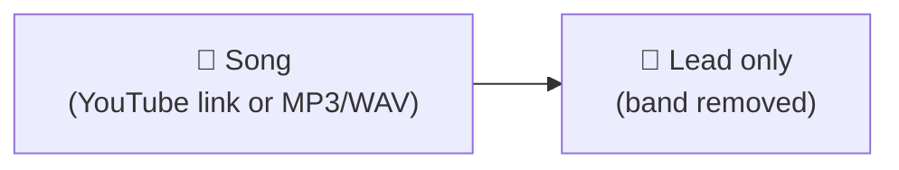
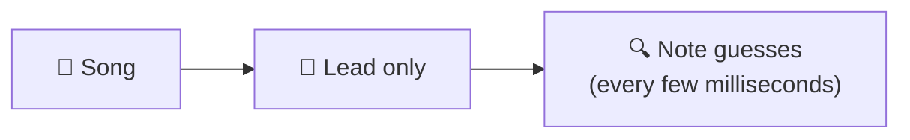
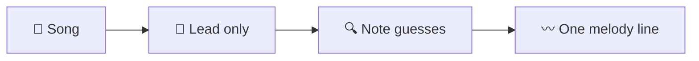
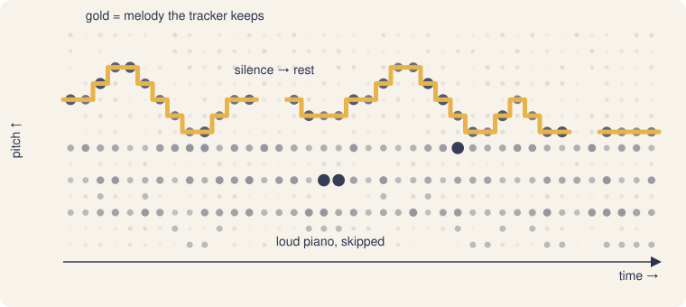
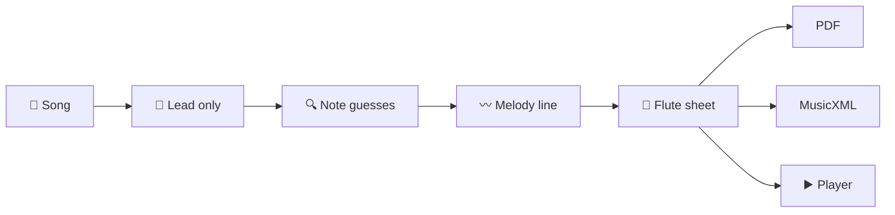

# How Trowa works

Trowa listens to a song, finds the tune someone would hum, and writes it down as flute sheet music. It does this in four steps. Each diagram below adds one step.

## 1. Pull out the lead

A song is a singer or lead instrument on top of drums, bass and chords. Trowa first tries to remove everything except the lead.

The server downloads YouTube audio with `yt-dlp`. Then it runs Demucs, an AI model that splits a song into the voice and the rest. If Demucs isn't installed, or it hands back near silence (common when the lead is a flute rather than a voice), a simpler filter takes over. It keeps the middle of the sound, where melodies usually sit.

## 2. Guess which notes are sounding

Spotify's Basic Pitch, another AI model, runs in your browser. Many times a second, it says how likely each note is to be sounding. The output is messy. A piano chord, an echo or a cymbal all light up notes that aren't the melody.

## 3. Follow the melody

This is the hard part. The guesses below are dots, brighter where the model is more sure. The melody isn't always the brightest dot. A loud piano chord can outshine the voice for a moment.

*An illustration, not real model output.*

The tracker picks the line that best explains the whole passage, not the loudest note at each instant. It uses three rules:

- **Stay put when you can.** Holding a note is free, and jumping costs a little, more for big jumps. So a held voice beats a piano arpeggio that is louder for a split second.
- **Silence is allowed.** If nothing fits, the line goes quiet. A part the flute can't play becomes a rest, not a wrong note. We prefer missing a note to writing a wrong one.
- **Stay in your range.** A second pass pulls back notes that wander far from where the tune usually sits. This keeps the line on the melody when the piano plays it an octave lower.

The technical name for this is a Viterbi search. The code is in `src/pipeline/track.ts`.

## 4. Write the sheet

A melody line is a list of pitches with start and end times. Sheet music needs beats. Trowa finds the tempo and lines each note up on the nearest beat. It finds the key and moves notes into the flute's range, so a note that came out an octave too low is raised. It joins eighth notes into beamed groups. The result is a MusicXML file. The page draws it, jsPDF turns it into a PDF, the player plays it, and Transpose moves it to another key.

All the listening and writing happens in a background thread. The particle animation keeps moving while it works.

## What still goes wrong

- **Busy songs lose or gain notes.** When the piano plays the melody an octave lower, the line can drop an octave for a phrase. A piano note that rings on during a pause can show up as a held note.
- **Free tempo is hard.** On slow songs where the player speeds up and slows down, the tempo can be a few percent off.
- **Demucs can hurt clean input.** On a single clean melody, removing the band removes nothing useful and adds noise. Run with `TROWA_DEMUCS=off` for that.
- **The first run is slow.** Demucs on a laptop CPU takes about 4.5 minutes for a 3.5 minute song. Later runs of the same song are cached.

[benchmark.md](benchmark.md) shows how often it gets the melody right.

## Where the code lives

| Folder | What's in it |
| --- | --- |
| `server/index.js` | Downloads YouTube audio and runs Demucs. |
| `src/pipeline/` | Steps 2 to 4, as plain functions with tests. |
| `src/ui/`, `src/particles/`, `src/result/` | The three screens and the animation. |
| `src/domain.ts` | The shared types. |

## Checking the player

`scripts/player-pitch-check.ts` checks that the player plays what the sheet says. Download the WAV with the Audio button and the score with the MusicXML button. `node scripts/sheet-download.mjs <server> <youtube url> <dir>` does both without a browser. Then run `npx tsx scripts/player-pitch-check.ts song.wav song.musicxml`. It measures the pitch in the middle of every note and fails unless each one matches the score.
